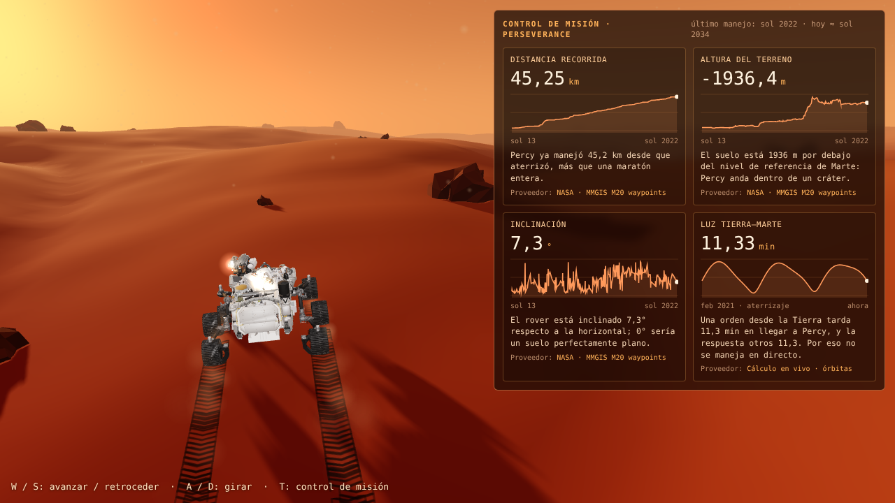
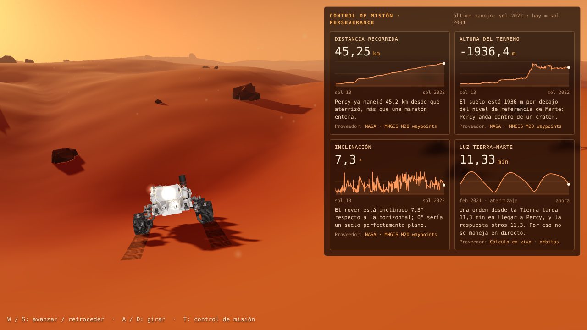
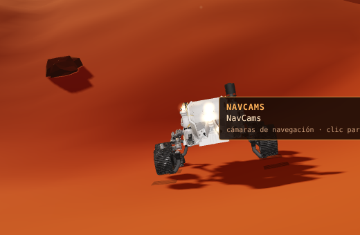

# Mars with Percy: a 3D Mars landscape

**Language / Idioma:** [English](#english) · [Español](#español)

---

<a id="english"></a>

# English



## What this is

A cinematic 3D Mars landscape you can drive through with NASA's Perseverance rover ("Percy"), running in the browser.

This is a **personal project**. I built it to **compare different AI models** as part of my ongoing training as a programmer who works with AI. I gave each model the same series of requests, one after another, and looked at what each one built, how it checked its own work, and where it got stuck. This version was built in **Claude Cowork** (Claude Sonnet 5.5).

It is not an official NASA product, and NASA does not endorse it.

## What it does

- **Landscape:** procedural dunes and rocks, a caramel dusty sky, a late-afternoon sun with soft shadows, and both Martian moons (Phobos and Deimos).
- **The real rover:** NASA's official 3D model of Perseverance, scaled to its real size (about 2.7 m wide).
- **Driving:** WASD controls, tracks left by each wheel, and a camera that follows the rover. Slopes slow the rover going uphill and pull it downhill, with Martian gravity.
- **Wheel physics:** the six wheels are separated from the model. Each one spins with the real speed of its point on the rover, the four corner wheels steer, and each wheel has its own spring suspension over the terrain and kicks up dust.
- **Mission control:** an in-game panel, built on the pattern I found in NASA's open-source [Open MCT](https://github.com/nasa/openmct) (every datum has a name, a unit and a provider). It shows four real values, each with a chart of the whole mission and a one-line plain explanation:
  - Distance driven, terrain height and tilt, from NASA's drive history (`M20_waypoints.json`).
  - Earth–Mars light time, calculated live from the planets' orbits.
- **Cameras:** four glowing dots sit on Percy's real camera parts (Mastcam-Z, NavCams, front Hazcams and WATSON). Hover to see the name. Click to fire the camera (shutter sound and flash) and reveal a real photo little by little. Click again to enlarge, arrow keys to browse, Esc to go back to the game. Each photo shows the camera, the sol and how many days ago it was taken.
- **A check script:** `npm run check` opens the page in headless Chrome, drives the rover, clicks each camera, saves screenshots and fails if there are console errors.

| Mission control | Camera dots |
|---|---|
|  |  |

## Current status

- Working: landscape, rover, driving, wheel physics, mission control with the four real values, camera dots and the photo viewer.
- **Not included yet:** the real Mars photos. They come from NASA's raw-images API, which I could not reach from my build environment, so the photos have to be downloaded on your own machine (see below). Until you do that, clicking a camera shows a message saying there are no photos yet. The screenshots above do not show any photo.
- The mission-control data comes from NASA's drive history, which ends at sol 2022, so distance, height and tilt are the **last known values in that file**, not today's.
- The suspension arms of the rover do not bend. The model ships them as a single piece, so only the wheels move.

## How to run it

You need **Node.js 18 or newer**. Nothing else has to be installed globally.

```bash
npm install
npm run dev
```

Open <http://localhost:5173> in your browser.

| Key | Action |
|---|---|
| `W` / `S` | Drive forward / backward |
| `A` / `D` | Turn |
| `T` | Show or hide the mission-control panel |
| Mouse over a glowing dot | See the camera's name |
| Click a glowing dot | Take a photo |
| `←` / `→` in the viewer | Previous / next photo of that camera |
| Click in the viewer | Enlarge / shrink |
| `Esc` | Close the viewer and go back to the game |

### Getting the real photos

1. Run `npm run fotos`. It needs internet and downloads about 60 recent candidate photos per camera into `public/photos/candidatos/`, with their data (camera, sol, date). Use `npm run fotos -- --por 100` for more.
2. Look through them and pick the most striking ones (in color, with horizon, arm over the ground or close rocks; no empty sky, sun, calibration targets or thumbnails).
3. Save your picks in `public/photos/seleccion.json`:

```json
{
  "Mastcam_Z_cams": [
    { "archivo": "candidatos/Mastcam_Z_cams/12345.jpg", "sol": 1500, "fecha": "2026-10-30T09:12:00Z", "camara": "MCZ_LEFT", "id": "12345" }
  ],
  "NavCams": [],
  "hazcams_front": [],
  "WATSON": []
}
```

The keys are the part names in the 3D model. `archivo` is relative to `public/photos/`. Many NavCam and Hazcam raw images are black and white, so color photos may be scarce for those cameras.

### The check script

```bash
npm run check
```

It uses your installed Google Chrome through Playwright and downloads no browsers. If Chrome is somewhere unusual, set `CHROME_PATH`. It prints the values of the four mission-control data, tests the `T` key, clicks every camera and saves screenshots to `captures/`. It fails while the photos are missing, on purpose. On a machine without a GPU, software rendering makes it slow (several minutes).

## Project structure

```
index.html            page and controls hint
src/main.js           scene, terrain, sky, rover, driving, camera, tracks
src/wheels.js         wheel separation, spin, steering, suspension, dust
src/mission.js        mission-control panel and its data providers
src/camaras.js        camera dots, hover label, photo viewer
scripts/check.mjs     npm run check
scripts/fotos.mjs     npm run fotos
public/models/        NASA Perseverance 3D model (.glb)
public/data/          NASA drive history (M20_waypoints.json)
public/draco/         decoder for the compressed 3D model
```

## Possible upgrades

- Add the curated real photos, and show them inside the world (for example as images that float next to the rover when a camera fires).
- Bend the rocker-bogie suspension: split the single suspension mesh so arms and bogies move with the terrain.
- Replace the procedural terrain with real Jezero Crater elevation data.
- Replay Percy's real traverse by driving the rover along the actual waypoints, with a timeline of sols.
- Connect the game to a real Open MCT instance: a plugin that publishes Percy's speed, pitch and roll as live telemetry.
- A day and night cycle tied to the real local solar time, dust storms and atmospheric scattering.
- Ambient wind and wheel sounds, and animation of the robotic arm and mast.
- Gamepad and touch controls, so it plays on a phone.
- Lighter rover model (it has about 600,000 triangles) for weaker machines.
- A small benchmark harness to repeat the model comparison automatically and keep the results in this repository.
- Publish it online with GitHub Pages.

## Model comparison (to fill in)

| Model | Tool | Strengths | Where it struggled | Notes |
|---|---|---|---|---|
| Claude Sonnet 5.5 | Claude Cowork | _to fill in_ | _to fill in_ | This version |
| _another model_ | _tool_ | | | |

## Credits

- 3D model of Perseverance: [NASA 3D Resources](https://github.com/nasa/NASA-3D-Resources).
- Drive history: NASA/JPL-Caltech, MMGIS Mars 2020 (`M20_waypoints.json`).
- Raw photos: NASA Mars 2020 raw images feed.
- Pattern for the mission-control panel: [Open MCT](https://github.com/nasa/openmct), NASA's open-source mission-control software.
- Built with [three.js](https://threejs.org/) and [Vite](https://vitejs.dev/).
- NASA material belongs to NASA and its partners and is used here for learning. Please check NASA's media usage guidelines before reusing it.

---

<a id="español"></a>

# Español


## Qué es

Un paisaje de Marte en 3D, con aspecto de película, por el que puedes manejar al rover Perseverance de la NASA ("Percy"), directamente en el navegador.

Es un **proyecto personal**. Lo hice para **comparar distintos modelos de IA** dentro de mi formación continua como programador que trabaja con IA. A cada modelo le di la misma serie de pedidos, uno tras otro, y miré qué construyó, cómo revisó su propio trabajo y dónde se atascó. Esta versión se hizo en **Claude Cowork** (Claude Sonnet 5.5).

No es un producto oficial de la NASA y la NASA no lo respalda.

## Qué hace

- **Paisaje:** dunas y rocas generadas por código, cielo color caramelo con polvo, un sol de tarde con sombras suaves y las dos lunas de Marte (Fobos y Deimos).
- **El rover de verdad:** el modelo 3D oficial de Perseverance de la NASA, a tamaño real (unos 2,7 m de ancho).
- **Manejo:** teclas WASD, huellas de cada rueda y una cámara que lo sigue. Las cuestas lo frenan al subir y lo empujan al bajar, con la gravedad de Marte.
- **Física de las ruedas:** las seis ruedas están separadas del modelo. Cada una gira con la velocidad real de su punto del rover, las cuatro de las esquinas giran de dirección, y cada una tiene su propia suspensión con resorte sobre el terreno y levanta polvo.
- **Control de misión:** un panel dentro del juego, hecho con el patrón que encontré en [Open MCT](https://github.com/nasa/openmct), el software libre de control de misión de la NASA (cada dato tiene nombre, unidad y proveedor). Muestra cuatro valores reales, cada uno con una gráfica de toda la misión y una frase simple que explica qué significa:
  - Distancia recorrida, altura del terreno e inclinación, del historial de manejos de la NASA (`M20_waypoints.json`).
  - Tiempo de luz entre la Tierra y Marte, calculado en vivo con las órbitas de los planetas.
- **Cámaras:** cuatro puntos que brillan sobre las piezas reales de cámara de Percy (Mastcam-Z, NavCams, Hazcams delanteras y WATSON). Al pasar el mouse se ve el nombre. Un clic dispara la cámara (sonido de obturador y flash) y revela una foto real poco a poco. Otro clic la amplía, las flechas pasan a otras fotos y Esc vuelve al juego. Cada foto dice la cámara, el sol y hace cuántos días se tomó.
- **Un script de revisión:** `npm run check` abre la página en un Chrome sin ventana, maneja el rover, hace clic en cada cámara, guarda capturas y falla si hay errores en la consola.

| Control de misión | Puntos de cámara |
|---|---|
|  |  |

## Estado actual

- Funciona: paisaje, rover, manejo, física de las ruedas, control de misión con los cuatro valores reales, puntos de cámara y visor de fotos.
- **Todavía no incluye** las fotos reales de Marte. Vienen de la API de imágenes crudas de la NASA, a la que no pude llegar desde mi entorno de construcción, así que las fotos hay que descargarlas en tu propia computadora (ver abajo). Mientras tanto, al hacer clic en una cámara aparece un aviso de que aún no hay fotos. Las capturas de arriba no muestran ninguna foto.
- Los datos del control de misión salen del historial de manejos de la NASA, que termina en el sol 2022. Por eso la distancia, la altura y la inclinación son los **últimos valores conocidos de ese archivo**, no los de hoy.
- Los brazos de la suspensión del rover no se doblan. El modelo los trae como una sola pieza, así que solo se mueven las ruedas.

## Cómo usarlo

Necesitas **Node.js 18 o superior**. No hace falta instalar nada más de forma global.

```bash
npm install
npm run dev
```

Abre <http://localhost:5173> en el navegador.

| Tecla | Acción |
|---|---|
| `W` / `S` | Avanzar / retroceder |
| `A` / `D` | Girar |
| `T` | Mostrar u ocultar el panel de control de misión |
| Mouse sobre un punto brillante | Ver el nombre de la cámara |
| Clic en un punto brillante | Tomar una foto |
| `←` / `→` en el visor | Foto anterior / siguiente de esa cámara |
| Clic en el visor | Ampliar / reducir |
| `Esc` | Cerrar el visor y volver al juego |

### Conseguir las fotos reales

1. Corre `npm run fotos`. Necesita internet y descarga unas 60 fotos candidatas recientes por cámara en `public/photos/candidatos/`, con sus datos (cámara, sol, fecha). Con `npm run fotos -- --por 100` bajas más.
2. Revísalas y elige las más impresionantes (a color, con horizonte, el brazo sobre el suelo o rocas de cerca; sin cielo vacío, sol, calibración ni miniaturas).
3. Guarda tu selección en `public/photos/seleccion.json`:

```json
{
  "Mastcam_Z_cams": [
    { "archivo": "candidatos/Mastcam_Z_cams/12345.jpg", "sol": 1500, "fecha": "2026-10-30T09:12:00Z", "camara": "MCZ_LEFT", "id": "12345" }
  ],
  "NavCams": [],
  "hazcams_front": [],
  "WATSON": []
}
```

Las claves son los nombres de las piezas del modelo 3D. `archivo` es relativo a `public/photos/`. Muchas fotos crudas de las NavCams y las Hazcams son en blanco y negro, así que puede haber pocas a color para esas cámaras.

### El script de revisión

```bash
npm run check
```

Usa tu Google Chrome instalado a través de Playwright y no descarga navegadores. Si tu Chrome está en un lugar poco común, define `CHROME_PATH`. Imprime los valores de los cuatro datos del control de misión, prueba la tecla `T`, hace clic en cada cámara y guarda capturas en `captures/`. Falla mientras falten las fotos, a propósito. En una máquina sin tarjeta gráfica, el render por software lo hace lento (varios minutos).

## Estructura del proyecto

```
index.html            página y ayuda de teclas
src/main.js           escena, terreno, cielo, rover, manejo, cámara, huellas
src/wheels.js         separación de ruedas, giro, dirección, suspensión, polvo
src/mission.js        panel de control de misión y sus proveedores de datos
src/camaras.js        puntos de cámara, etiqueta y visor de fotos
scripts/check.mjs     npm run check
scripts/fotos.mjs     npm run fotos
public/models/        modelo 3D de Perseverance de la NASA (.glb)
public/data/          historial de manejos de la NASA (M20_waypoints.json)
public/draco/         decodificador del modelo 3D comprimido
```

## Posibles mejoras futuras

- Agregar las fotos reales elegidas y mostrarlas dentro del mundo (por ejemplo, como imágenes que flotan junto al rover cuando dispara una cámara).
- Doblar la suspensión rocker-bogie: separar la malla única de la suspensión para que brazos y bogies se muevan con el terreno.
- Cambiar el terreno generado por código por datos reales de elevación del cráter Jezero.
- Repetir el recorrido real de Percy manejando el rover sobre los waypoints reales, con una línea de tiempo de soles.
- Conectar el juego a una instancia real de Open MCT: un plugin que publique la velocidad, el cabeceo y el alabeo de Percy como telemetría en vivo.
- Ciclo de día y noche según la hora solar local real, tormentas de polvo y dispersión atmosférica.
- Sonido ambiente del viento y de las ruedas, y animación del brazo robótico y del mástil.
- Controles de gamepad y táctiles, para jugarlo en el celular.
- Un modelo del rover más liviano (tiene unos 600.000 triángulos) para máquinas modestas.
- Un pequeño banco de pruebas para repetir la comparación de modelos de forma automática y guardar los resultados en este repositorio.
- Publicarlo en línea con GitHub Pages.

## Comparación de modelos (por completar)

| Modelo | Herramienta | Fortalezas | Dónde le costó | Notas |
|---|---|---|---|---|
| Claude Sonnet 5.5 | Claude Cowork | _por completar_ | _por completar_ | Esta versión |
| _otro modelo_ | _herramienta_ | | | |

## Créditos

- Modelo 3D de Perseverance: [NASA 3D Resources](https://github.com/nasa/NASA-3D-Resources).
- Historial de manejos: NASA/JPL-Caltech, MMGIS Mars 2020 (`M20_waypoints.json`).
- Fotos crudas: feed de imágenes crudas de Mars 2020 de la NASA.
- Patrón del panel de control de misión: [Open MCT](https://github.com/nasa/openmct), el software libre de control de misión de la NASA.
- Hecho con [three.js](https://threejs.org/) y [Vite](https://vitejs.dev/).
- El material de la NASA pertenece a la NASA y sus socios y se usa aquí con fines de aprendizaje. Revisa las normas de uso de medios de la NASA antes de reutilizarlo.
